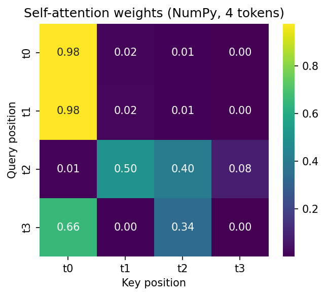
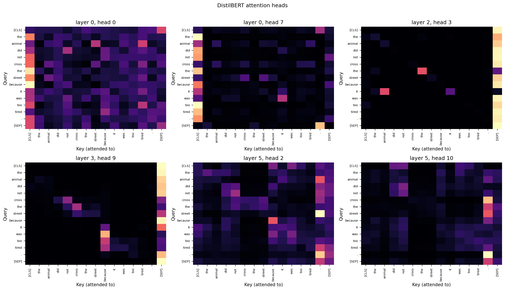
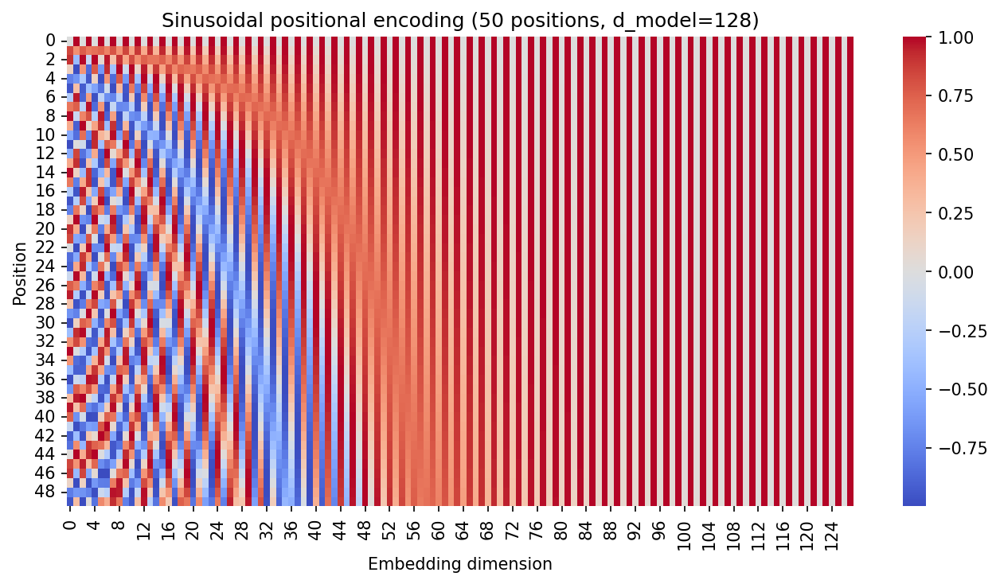
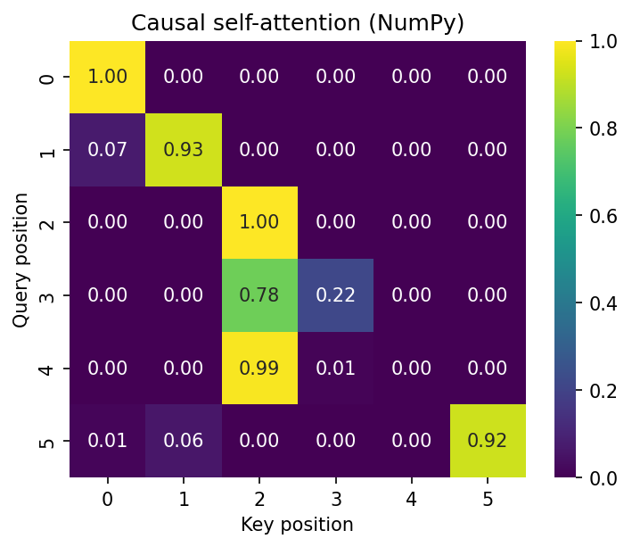
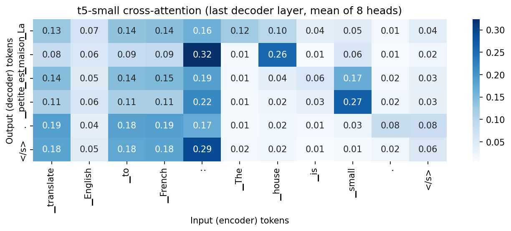
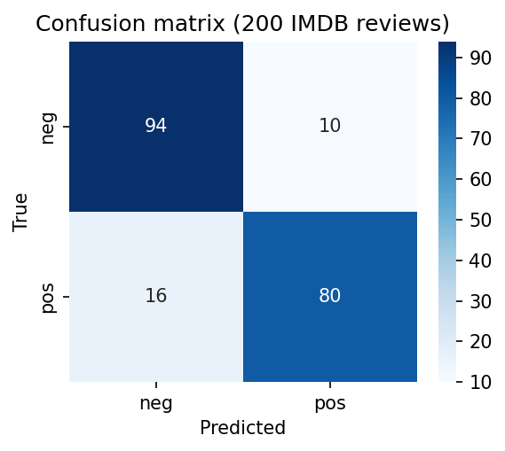
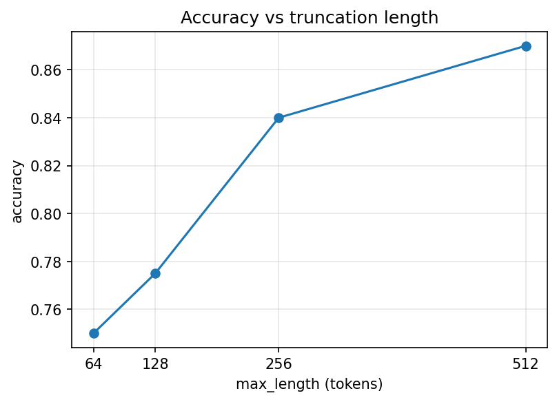
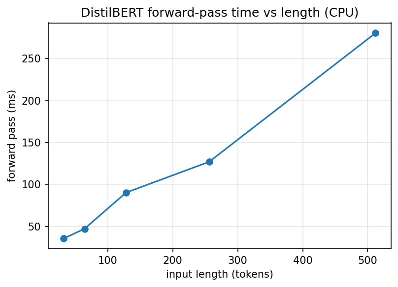

# DL PR 6 — Opening the Transformer: Attention, Encoder, Decoder and Inference

**Deep Learning · Practical Report 6**
**Author:** ishan tejani · **GRID:** 11078

No model is trained or fine-tuned in this project. Small pretrained Hugging Face models are run, inspected, and checked against NumPy re-implementations of the key Transformer equations.

---

## Video

Video explanation (face + screen, 5–10 min): **PASTE_YOUR_VIDEO_LINK_HERE**
(File name: `DL_PR6_YourName_GRID.mp4`)

---

## Models used

| Hugging Face model ID | Architecture | Used for |
|---|---|---|
| `distilbert-base-uncased-finetuned-sst-2-english` | Encoder-only (6 layers, 12 heads) | Sentiment analysis, attention inspection, encoder anatomy, positional and layer-norm study |
| `distilbert-base-uncased` | Encoder-only | Fill-mask (Task 4.4) |
| `gpt2` | Decoder-only (12 layers, 12 heads) | Causal attention, text generation, manual inference loop, KV-cache |
| `t5-small` | Encoder-decoder (6 + 6 layers, 8 heads) | Cross-attention, translation, summarisation |

Data: 200-review sample of the public IMDB test set (`load_dataset("stanfordnlp/imdb", split="test").shuffle(seed=42).select(range(200))`) plus 3 own passages.

---

## Repository structure

```
DL_PR6.ipynb          # complete notebook (Tasks 1–6)
DL_PR6.html           # HTML export of the executed notebook
requirements.txt      # library versions actually used
README.md
plots/
  attention_scratch.png
  attention_heads.png
  head_entropy.png
  positional_encoding.png
  learned_positions.png
  parameter_distribution.png
  bidirectional_attention.png
  causal_mask.png
  bidirectional_vs_causal.png
  cross_attention.png
  confusion_matrix.png
  truncation_accuracy.png
  time_vs_length.png
```


## Concepts explained

### Self-attention (scaled dot-product)
Each token is projected into a Query (what am I looking for), a Key (what do I offer) and a Value (what do I pass on). Scores `QKᵀ / √d_k` pass through a softmax, and a token's new representation is the weighted average of all Value vectors. The whole sequence is processed in parallel, unlike an RNN. I implemented this in NumPy, confirmed that every row of the weight matrix sums to 1, and **recomputed layer 0 / head 0 of DistilBERT from its own `q_lin` and `k_lin` weights, matching the real attention matrix with `np.allclose` (max absolute difference: `FILL_IN`)**. Dividing by √d_k keeps the dot-product variance near 1; without it, large `d_k` pushes softmax into a saturated region where one weight is almost 1 and gradients almost vanish (shown at `d_k = 4` and `256`). Self-attention is also order-blind: shuffling the input rows only shuffles the output rows.


*Figure 1 — Attention weights of a 4-token sequence computed from scratch in NumPy.*

### Multi-head attention
One attention pattern per layer is too limiting. With *h* heads, `d_model` is split into smaller subspaces (DistilBERT: 768 = 12 × 64). Each head learns its own Q, K, V projections and pattern, the outputs are concatenated and mixed by an output projection, and the total computation stays about the same as one big head. Plotting six real heads showed different behaviours: `DESCRIBE_TWO_BEHAVIOURS_FROM_YOUR_PLOT`.


*Figure 2 — Six DistilBERT heads (mixed layers) on "The animal did not cross the street because it was too tired."*

### Positional encoding
Because attention ignores order, position information must be added. The original Transformer uses sines and cosines of different frequencies, which give every position a unique pattern and make relative offsets easy to learn. Adding PE makes the same word at positions 3 and 20 differ (cosine similarity `FILL_IN`, versus 1.0 without PE). BERT-style models such as DistilBERT instead **learn** one vector per position; the table has 512 rows, which is the origin of the 512-token context limit. T5 uses relative position biases.


*Figure 3 — Sinusoidal positional encoding, 50 positions × 128 dimensions.*

### Layer normalization
LayerNorm normalises the features of each single token (mean ≈ 0, std ≈ 1), then applies a learned scale `gamma` and shift `beta` (both of size 768 in DistilBERT). My NumPy version matches `torch.nn.LayerNorm`. BatchNorm normalises each feature across the batch, so per-token statistics are not normalised, it depends on batch size, and padding in variable-length sequences distorts its statistics, which is why Transformers use LayerNorm.

### Masked (causal) self-attention
An encoder lets every token see tokens on both sides. A language model that predicts the next word must not see the future, so −∞ is added above the diagonal of the score matrix before the softmax. This gives exactly zero weight to future tokens while the remaining weights still sum to 1. The NumPy mask produced a lower-triangular matrix, and GPT-2's real attention confirmed it (`np.triu(attn, k=1).max() < 1e-6`). A separate padding mask blocks `[PAD]` columns and is used by all families.


*Figure 4 — Causal self-attention computed from scratch (lower-triangular, rows sum to 1).*

### Cross-attention
In the encoder-decoder model T5, the decoder's Queries come from the decoder while the Keys and Values come from the encoder output. This lets the decoder look at the source sentence while writing the target sentence; it is the Transformer version of Luong attention. The heatmap for "The house is small." → "La maison est petite." shows `DESCRIBE_ALIGNMENT_FROM_YOUR_PLOT`.


*Figure 5 — t5-small cross-attention (last decoder layer, mean of 8 heads): output tokens vs input tokens.*

### Inference
A decoder generates one token at a time: it predicts the next token from the last position, appends it to the input, and repeats. My manual greedy loop on GPT-2 produced output **identical** to `model.generate(do_sample=False)`. Five decoding strategies were compared (greedy, beam search, temperature 0.7 and 1.5, top-k + top-p). The KV-cache stores the keys and values of earlier tokens so they are not recomputed at every step: generating 100 tokens took `FILL_IN` s with cache versus `FILL_IN` s without (speed-up `FILL_IN`×).

---

## Evaluation results

Pretrained `distilbert-base-uncased-finetuned-sst-2-english` on 200 IMDB reviews (no training; the model was fine-tuned on a different dataset):

| Metric | Value |
|---|---|
| Accuracy | FILL_IN |
| Precision | FILL_IN |
| Recall | FILL_IN |
| F1 | FILL_IN |


*Figure 6 — Confusion matrix on 200 IMDB reviews.*

Truncation study:

| max_length | Accuracy | Time (s) |
|---|---|---|
| 64 | FILL_IN | FILL_IN |
| 128 | FILL_IN | FILL_IN |
| 256 | FILL_IN | FILL_IN |
| 512 | FILL_IN | FILL_IN |

Reviews longer than 512 tokens (lose text even at the maximum setting): **FILL_IN / 200**.


*Figure 7 — Accuracy against maximum input length.*

---

## Two disadvantages measured

1. **Fixed context window and quadratic cost.** A forward pass at 256 tokens took `FILL_IN` ms versus `FILL_IN` ms at 512 tokens (ratio `FILL_IN`; 2.0 would be linear, 4.0 fully quadratic). On a CPU the curve can look closer to linear at small sizes because the feed-forward layers dominate. `FILL_IN` of 200 reviews exceeded 512 tokens and lost text.

   
   *Figure 8 — DistilBERT forward-pass time against input length (CPU).*

2. **Hallucination.** GPT-2 was asked three factual prompts with greedy decoding; `FILL_IN` of 3 were graded correct. It predicts a likely next word, not a true one, so fluent output can still be wrong.

---

## Mini application

`text_toolkit(text)` returns, for any input text: (a) sentiment label and score (DistilBERT), (b) a short summary (t5-small, `max_length=60`), and (c) the French translation of the summary (t5-small). It was tested on a product review, a news paragraph, and my own passage, and handles empty and very long inputs with a clear message and truncation.

---

## Notes

- With `transformers` v5, the `summarization` and `translation_en_to_fr` pipelines were removed, so T5 is called directly with `generate()` and the task prefix (`summarize:` / `translate English to French:`).
- Attention weights need `attn_implementation="eager"` and `output_attentions=True`.

## What I learned

Short reflection is in section 6.6 of the notebook.
